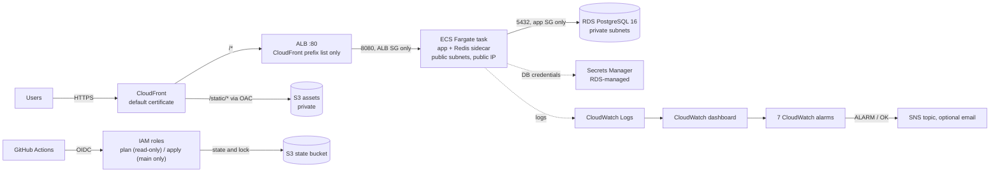

# CloudKit

[](https://github.com/iboondk/cloudkit/actions/workflows/ci.yml)

> **Placeholders:** the badge above and the clone URL in the Quick start are placeholders. This local repository has no git remote, and the URL has not been verified to exist. They become real once the repository is pushed.
>

CloudKit is a reference deployment of the [Tenantly](https://github.com/iboondk/tenantly) API on AWS. It contains Terraform modules, GitHub Actions workflows that authenticate with OIDC, an Ansible hardening role, and CloudWatch monitoring.

**Status: nothing here has been deployed.** The repository has been checked only with the offline tools listed under [Verification](#verification). It has never been applied to a real AWS account.

## Architecture



The full diagram, request flow and known limits are in [docs/architecture.md](docs/architecture.md). Each significant decision has an Architecture Decision Record in [docs/](docs/): [ADR-0001](docs/ADR-0001-no-nat-gateway.md) to [ADR-0006](docs/ADR-0006-offline-tests-without-credentials.md). Cost estimates are in [docs/cost.md](docs/cost.md).

## Repository layout

| Path | Contents |
|---|---|
| `terraform/modules/` | `network`, `db`, `compute`, `edge`, `observability` |
| `terraform/envs/dev/` | Root that wires the modules together, plus the offline mock plan in `tests/plan.tftest.hcl` |
| `terraform/bootstrap/` | State bucket, GitHub OIDC provider and plan/apply roles. Local state, applied once by a person |
| `.github/workflows/` | `ci.yml` (credential-free checks), `terraform-plan.yml` (pull requests), `terraform-apply.yml` (main, `production` environment) |
| `ansible/` | `hardening` role and `site.yml` for host hardening |
| `scripts/` | `validate.sh` (static checks, skips tools that are missing) and `teardown.sh` (dry-run by default) |
| `tests/` | Python `unittest` structural and hygiene tests |
| `docs/` | Architecture, cost, ADRs and captured proof output |

## Quick start

Docker Compose is not applicable to this repository. CloudKit is infrastructure code, not a service that runs locally, and the Tenantly container image is not built here. The closest single-command equivalent is the offline check suite below. It needs only Python 3 and PyYAML and touches no cloud account.

```bash
git clone https://github.com/iboondk/cloudkit.git
cd cloudkit

# 1. Install the one Python dependency (PyYAML 6.0.3).
python3 -m pip install "pyyaml==6.0.3"

# 2. Run the structural and hygiene tests (no network, no credentials).
python3 -m unittest discover -s tests -v

# 3. Confirm the teardown script runs nothing by default.
bash scripts/teardown.sh --dry-run

# 4. Run every static check the local tools allow.
#    Missing tools print "SKIP: <tool> not installed" and are not counted as passing.
bash scripts/validate.sh
```

Optional offline Terraform check, only if `terraform` 1.10 or later is on your PATH:

```bash
terraform -chdir=terraform/envs/dev init -backend=false -input=false
terraform -chdir=terraform/envs/dev test
```

Configuration for any real use starts from `.env.example` and `*.example` files. Copy them to git-ignored names (`.env`, `backend.hcl`, `terraform.tfvars`) and fill them in locally. No real credential belongs in this repository.

## Verification

| Check | Where it runs | Needs |
|---|---|---|
| `python3 -m unittest discover -s tests` | `ci.yml` and locally | Python 3, PyYAML |
| `terraform fmt`, `validate`, offline `terraform test` | `ci.yml`, `terraform-plan.yml`, `scripts/validate.sh` | Terraform |
| `ansible-playbook --syntax-check` | `ci.yml` and `scripts/validate.sh` | ansible-core, collections |
| `shellcheck scripts/*.sh` | `ci.yml` and `scripts/validate.sh` | shellcheck |

The offline Terraform test uses `mock_provider "aws"` with `command = plan`. It needs no credentials and never applies anything. A real `terraform plan` is not part of this repository's checks.

Captured output lives in [docs/proof/](docs/proof/). Only output from real runs is stored there. Captures whose origin has not been re-verified are kept separately in [docs/proof/unverified/](docs/proof/unverified/) and are not evidence of a passing check.

## CI and deployment

- **`ci.yml`** runs on every push to main and every pull request. It runs the unit tests, the teardown dry run, shellcheck, the offline Terraform checks and the Ansible syntax check. It uses no AWS credentials.
- **`terraform-plan.yml`** runs on pull requests that touch `terraform/`. It assumes a read-only role through OIDC and posts the plan as a pull request comment.
- **`terraform-apply.yml`** runs after a merge to main. It uses the `production` environment and an OIDC role that trusts only `main`.

No workflow in this repository has been executed on GitHub.

## Documentation

- [WRITEUP.md](WRITEUP.md): problem, architecture, key decisions, results and next steps.
- [DEMO.md](DEMO.md): step-by-step script for recording a GIF or Loom demo.
- [docs/architecture.md](docs/architecture.md), [docs/cost.md](docs/cost.md), [docs/ADR-0001-no-nat-gateway.md](docs/ADR-0001-no-nat-gateway.md) and the other ADRs in [docs/](docs/).

## License

MIT License. Copyright (c) 2026 iboondk. See [LICENSE](LICENSE).
