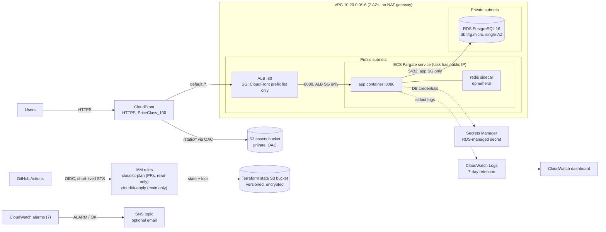

# CloudKit architecture

CloudKit deploys the [Tenantly](https://github.com/iboondk/tenantly) API on AWS (us-east-1) with Terraform, GitHub Actions and OIDC. The diagram below shows the dev stack as defined in `terraform/envs/dev`. The stack has not been deployed to a live account.



## Request flow

1. A user requests the CloudFront domain over HTTPS (default `*.cloudfront.net` certificate).
2. Requests for `/static/*` are served from the private S3 assets bucket through Origin Access Control.
3. All other requests go to the ALB over HTTP. The ALB security group admits port 80 only from the CloudFront origin-facing managed prefix list.
4. The ALB forwards to the ECS task on `container_port` (8080). The task security group admits that port only from the ALB security group.
5. The Go app reads PostgreSQL settings from `DB_*` variables. `DB_USER` and `DB_PASSWORD` come from the RDS-managed secret in Secrets Manager.
6. The app talks to the Redis sidecar on `localhost:6379` for rate limiting and cache.
7. RDS accepts 5432 only from the app security group. It has no route to the internet.

## Deploy flow

- **Pull request:** `terraform-plan.yml` assumes the read-only `cloudkit-plan` role through OIDC and runs fmt, validate, the offline mock plan, and a plan with state read access.
- **Merge to main:** `terraform-apply.yml` assumes `cloudkit-apply` through OIDC. That role trusts only `ref:refs/heads/main` and is gated by the `production` GitHub environment.
- **Bootstrap:** `terraform/bootstrap` uses local state and is applied once by a person. CI never applies it.
- **Image:** the app image is referenced by `var.container_image`. Its build and push are outside this repository.

## Security notes

- **No NAT gateway.** Tasks sit in public subnets with public IPs and pull images over the internet gateway. Their security group admits only ALB traffic. RDS stays in private subnets.
- **ALB restricted to CloudFront.** Port 80 is allowed only from the CloudFront managed prefix list.
- **RDS-managed master password** (`manage_master_user_password = true`). No password is in Terraform state or in tfvars.
- **OIDC, no static keys.** GitHub gets short-lived STS credentials. No long-lived AWS access key is stored in the repository or in GitHub secrets.
- **Least-privilege roles.** The plan role is read-only plus state access. The apply role is reachable only from `main`.
- **Secrets stay out of the repo.** `.env`, `backend.hcl` and `terraform.tfvars` are git-ignored. Only `*.example` placeholders are committed.

## Known limits

- **CloudFront to ALB is plain HTTP** inside AWS. The fix is a custom domain with an ACM certificate on the ALB, which is documented as an upgrade and not built.
- **Single-AZ RDS.** `db.t4g.micro` runs in one availability zone. An AZ outage stops the database. Multi-AZ is a cost and config change.
- **Redis sidecar is ephemeral.** Rate-limit counters and cache are lost when the task restarts. ElastiCache is the scale-up path.
- **No WAF.** The ALB and CloudFront have no web application firewall rules.
- **Public tasks.** Tasks have public IPs (the cost of avoiding NAT). Ingress is still limited to the ALB security group.
- **No measured performance data.** No load tests have been run. Capacity figures are not claimed.

## One-off migration task

Migrations (`cmd/migrate` in the Tenantly API) run as a one-off Fargate task that reuses the service's task definition with a command override. This is documented only. It has never been run here.

```bash
aws ecs run-task \
  --cluster cloudkit-dev-cluster \
  --task-definition <task-family-or-arn> \
  --launch-type FARGATE \
  --network-configuration "awsvpcConfiguration={subnets=[<public-subnet-id>],securityGroups=[<app-security-group-id>],assignPublicIp=ENABLED}" \
  --overrides '{"containerOverrides":[{"name":"app","command":["<migrate-command>"]}]}'
```

Replace the placeholders with values from `terraform output` and the ECS console. Do not run this against a real account from this repository without a reviewed change.

## Application assumptions

CloudKit deploys [Tenantly](https://github.com/iboondk/tenantly) (Go API, PostgreSQL 16 with RLS, Redis 7 for rate limiting and cache, `GET /healthz`, `cmd/migrate`). The deployment is parameterized and does not depend on application internals:

- The app ships as one OCI image (`var.container_image`). The placeholder default is `public.ecr.aws/nginx/nginx:stable`, so the stack can be planned before an app image exists.
- The container listens on `var.container_port` (default `8080`) and exposes `var.health_check_path` (default `/healthz`).
- It reads PostgreSQL settings from `DB_HOST`, `DB_PORT`, `DB_NAME`, `DB_USER`, `DB_PASSWORD` (the last two injected from the RDS-managed Secrets Manager secret), plus `PORT`, `APP_ENV=prod` and `REDIS_ADDR=localhost:6379`. An app that prefers a single `DATABASE_URL` can compose it in its entrypoint.
- Migrations (`cmd/migrate`) run as a one-off ECS task using the same task definition with a command override.
- Static assets live under `/static/*` and are served from S3 through CloudFront.

## Module interfaces


Every module takes `name` (string) and `tags` (map(string), default `{}`) and applies `tags` to every taggable resource.

**network**
- Inputs: `name`, `cidr_block` (default `"10.20.0.0/16"`), `az_count` (default `2`), `container_port` (default `8080`), `tags`.
- Outputs: `vpc_id`, `public_subnet_ids`, `private_subnet_ids`, `alb_security_group_id`, `app_security_group_id`, `db_security_group_id`.

**db**
- Inputs: `name`, `private_subnet_ids`, `db_security_group_id`, `db_name` (`"tenantly"`), `username` (`"tenantly"`), `instance_class` (`"db.t4g.micro"`), `allocated_storage` (`20`), `engine_version` (`"16"`), `deletion_protection` (`false`), `tags`.
- Outputs: `instance_id`, `address`, `port`, `db_name`, `master_user_secret_arn`.

**compute**
- Inputs: `name`, `aws_region`, `vpc_id`, `public_subnet_ids`, `alb_security_group_id`, `app_security_group_id`, `container_image`, `container_port` (`8080`), `health_check_path` (`"/healthz"`), `cpu` (`256`), `memory` (`512`), `desired_count` (`1`), `redis_image` (`"public.ecr.aws/docker/library/redis:7-alpine"`), `db_address`, `db_port`, `db_name`, `db_secret_arn`, `log_retention_days` (`7`), `tags`.
- Outputs: `cluster_name`, `service_name`, `alb_dns_name`, `alb_arn_suffix`, `target_group_arn_suffix`, `log_group_name`, `task_execution_role_arn`.

**edge**
- Inputs: `name`, `alb_dns_name`, `price_class` (`"PriceClass_100"`), `tags`.
- Outputs: `distribution_id`, `distribution_arn`, `distribution_domain_name`, `assets_bucket_name`.

**observability**
- Inputs: `name`, `aws_region`, `alb_arn_suffix`, `target_group_arn_suffix`, `ecs_cluster_name`, `ecs_service_name`, `db_instance_id`, `alarm_email` (default `""`, which means no subscription), `tags`.
- Outputs: `dashboard_name`, `sns_topic_arn`, `alarm_names` (list).

**envs/dev** wires network, db, compute, edge and observability together.
- Root variables: `aws_region`, `name`, `container_image`, `alarm_email`.
- Root outputs: `cloudfront_url`, `alb_dns_name`, `db_address`, `dashboard_name`, `sns_topic_arn`, `assets_bucket_name`.

**bootstrap** (local state, applied once by a human, never by CI)
- Inputs: `aws_region`, `github_owner`, `github_repo`, `state_bucket_name`.
- Outputs: `state_bucket_name`, `oidc_provider_arn`, `plan_role_arn`, `apply_role_arn`.

## IaC conventions

- Use `jsonencode()` for every IAM/bucket policy. Do not use the `aws_iam_policy_document` data source, so that mock-provider plans stay valid.
- Use only these data sources: `aws_availability_zones` and `aws_ec2_managed_prefix_list`. Each must have a `mock_data` default in the tftest file.
- CloudFront managed policy IDs are hardcoded as locals: CachingDisabled `4135ea2d-6df8-44a3-9df3-4b5a84be39ad`, CachingOptimized `658327ea-f89d-4fab-a63d-7e88639e58f6`, AllViewerExceptHostHeader `b689b0a8-53d0-40ab-baf2-68738e2966ac`.
- S3: use the separate `aws_s3_bucket_*` resources (versioning, SSE, public access block, policy). Do not use the deprecated inline arguments.

## Host hardening notes


- **Drop-in name:** the role writes `/etc/ssh/sshd_config.d/00-hardening.conf` (template `00-hardening.conf.j2`) rather than a `99-` file. sshd keeps the first value it reads for each keyword, so a `99-` file would lose to vendor drop-ins such as `50-cloud-init.conf` (Ubuntu) and `50-redhat.conf` (Amazon Linux 2023). The reasoning is recorded in `roles/hardening/defaults/main.yml`, in `tasks/ssh.yml`, and in `tests/test_ansible.py`.
- **Preflight import:** `tasks/preflight.yml` holds the SSH port lockout guard and the Ubuntu noble non-22 port guard. `tasks/main.yml` imports it first. `tests/test_ansible.py` checks that it is the first import.
- **Effective-config assert:** `tasks/ssh.yml` reads `sshd -T` and asserts the effective settings. Both run only in the real run, because the drop-in is not written in check mode. The read and the `ssh.socket` check set `check_mode: false` so `ansible-playbook --check` still works. The assert has `when: not ansible_check_mode`.
- **Root-login value:** the template writes `PermitRootLogin prohibit-password`. OpenSSH's `sshd -T` prints `permitrootlogin without-password` for that setting, so the effective-config assert accepts both spellings.
